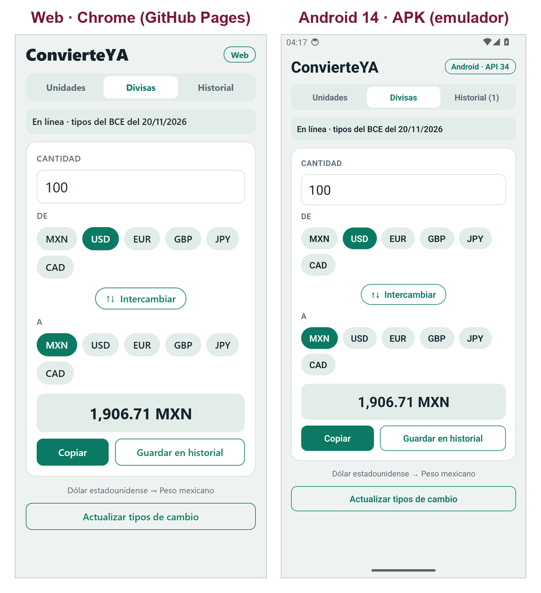
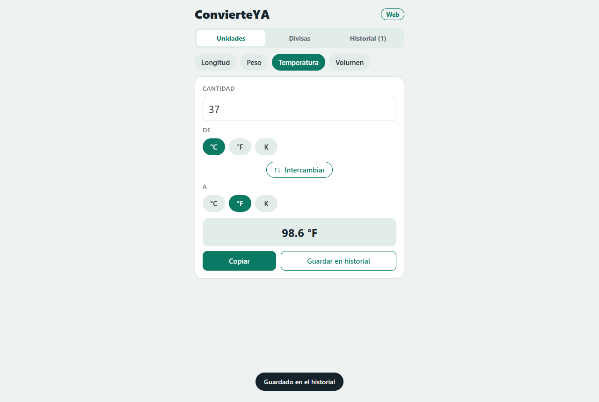
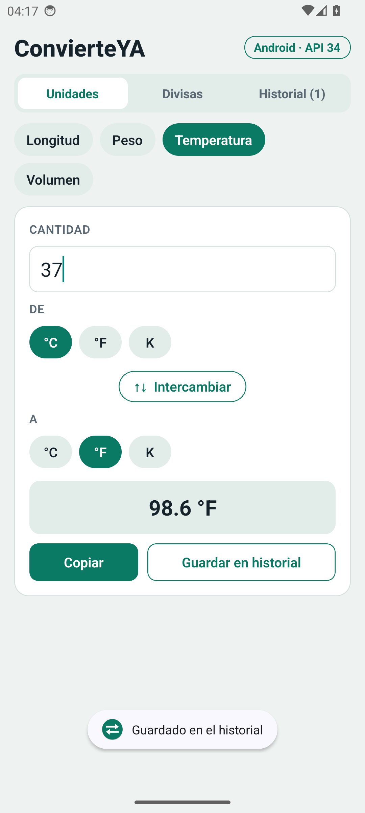
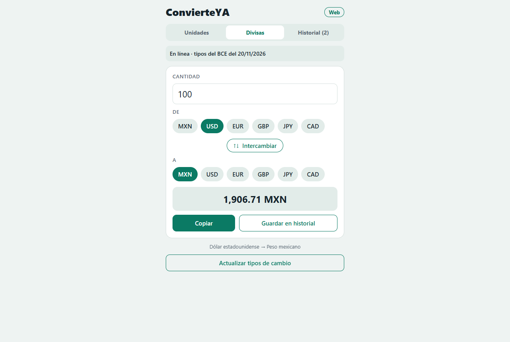
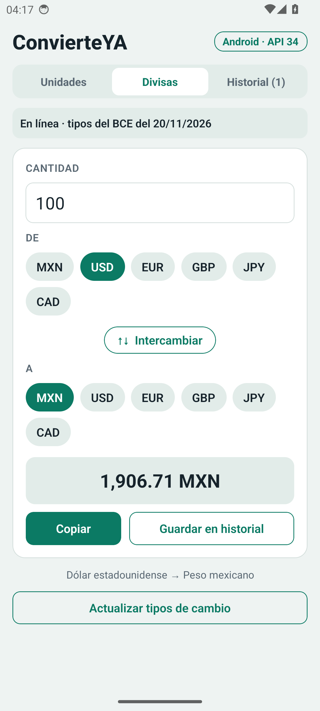
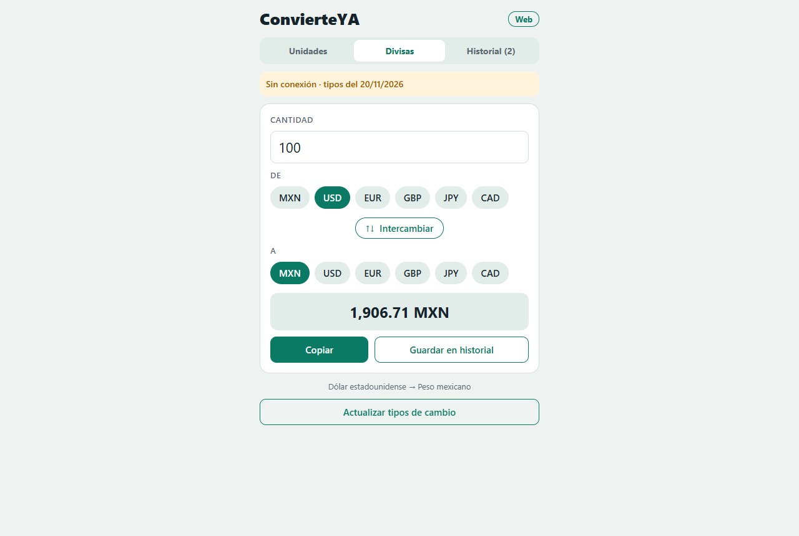
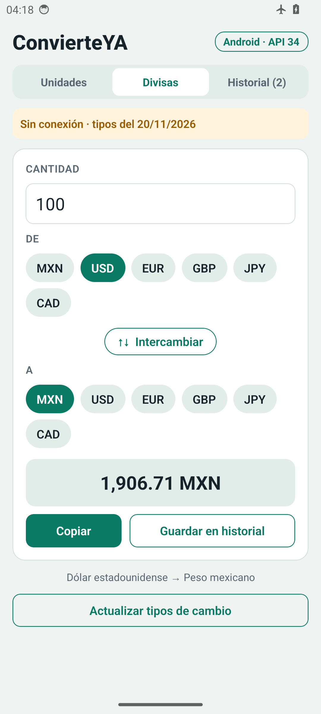

# ConvierteYA · Aplicación multiplataforma (React Native + Expo)

Conversor de **unidades** (longitud, peso, temperatura y volumen) y de **divisas** (API Frankfurter del Banco Central Europeo), con historial.
**Un solo código en JavaScript** corre en **Android, iOS y Web**.

> Subproducto No. 5 · Aplicaciones Web Progresivas · Unidad I · Jahir Jaziel Serrano Arana · 10° D

| Plataforma | Dónde probarla |
|---|---|
| 🌐 Web | **https://jazyelae.github.io/ConvierteYA-Multiplataforma/** |
| 🤖 Android | APK en [Releases](https://github.com/JazyelAe/ConvierteYA-Multiplataforma/releases/latest) |
| 🍎 iOS | Compatible por diseño (Expo). Para compilarlo se necesita una Mac o una cuenta de Expo/Apple; aquí **no se probó**. Se puede abrir con **Expo Go** (ver abajo). |

## La misma app en web y en Android



## Funciones
- **Unidades** con conversión en tiempo real mientras se escribe (coma o punto decimal).
- **Divisas** MXN, USD, EUR, GBP, JPY y CAD con tipos de cambio de [Frankfurter](https://frankfurter.dev). **Sin conexión** usa los últimos tipos guardados y muestra «Sin conexión · tipos del dd/mm/aaaa».
- **Historial** de las últimas 30 conversiones (AsyncStorage), que se borran una por una o todas.
- **Intercambiar** origen y destino, y **copiar** el resultado al portapapeles (`expo-clipboard`).
- Tema **claro u oscuro** según el sistema.

## ¿Qué cambia según la plataforma?
Todo el código está en `App.js` y `src/` y es el mismo. Lo único distinto se resuelve con `Platform.OS` en [`src/plataforma.js`](src/plataforma.js):

| | Android | iOS | Web |
|---|---|---|---|
| Aviso al copiar o guardar | `ToastAndroid` (nativo) | `Alert` (nativo) | Aviso dibujado por la app |
| Vibración háptica (`expo-haptics`) | Sí | Sí | No (el navegador no la tiene) |
| Etiqueta de plataforma | «Android · API 34» | «iOS» + versión | «Web» |
| Almacenamiento (AsyncStorage) | Almacenamiento de la app | Almacenamiento de la app | `localStorage` |

## Estructura
```
App.js                    Pantalla principal: encabezado, pestañas e historial
src/conversiones.js       Funciones puras de unidades y formato (con pruebas)
src/divisas.js            Monedas, URL de la API y conversión por el euro (con pruebas)
src/almacen.js            AsyncStorage: historial y respaldo de tipos de cambio
src/plataforma.js         Lo que cambia con Platform.OS (vibración y avisos)
src/tema.js               Colores claro/oscuro
src/componentes/          Opciones (chips) y Conversor (tarjeta compartida)
src/pantallas/            Unidades, Divisas e Historial
__tests__/                Pruebas jest
scripts/capturas.sh       Recorre la app en el emulador Android con adb
```

## Ejecutar en tu computadora
```bash
npm install
npm test          # pruebas de conversión (jest)
npm run web       # versión web en el navegador
```

### Abrirla en tu teléfono con Expo Go (sin cuenta)
1. Instala **Expo Go** desde Play Store o App Store.
2. En la computadora: `npx expo start --tunnel`
3. Escanea el código QR con Expo Go (Android) o con la cámara (iPhone).

## Cómo se publica (GitHub Actions)
- **`web.yml`**: en cada push corre `npm test`, `npx expo export -p web` y publica en GitHub Pages.
- **`android.yml`**: al crear una etiqueta `v*`, `npx expo prebuild -p android` genera el proyecto nativo y `./gradlew assembleRelease` compila el APK, que se adjunta al Release. **No usa EAS** ni cuenta de Expo. El APK va firmado con la llave de depuración: sirve para instalarlo y probarlo, no para publicarlo en Play Store.
- **`capturas.yml`**: instala el APK en un emulador Android 14 y toma capturas reales con adb.

## Capturas

| Web | Android |
|---|---|
|  |  |
|  |  |
|  |  |

## Tecnologías
React Native 0.88 · Expo SDK 58 · react-native-web · AsyncStorage · expo-clipboard · expo-haptics · jest · API Frankfurter.
